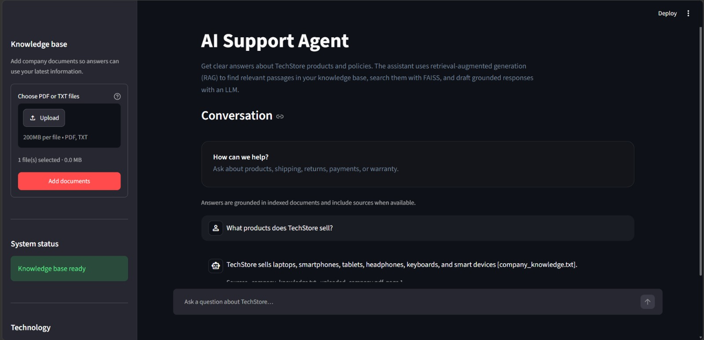

# TechStore AI Customer Support Agent

## Project Overview

TechStore AI Customer Support Agent is a Streamlit chatbot that uses
retrieval-augmented generation (RAG) to answer customer questions from company
documents. It ingests PDF and TXT files, indexes document chunks in a persistent
local FAISS vector store, retrieves relevant passages, and generates answers
with source citations.

## Demo



## Features

- RAG-based AI customer support grounded in the company knowledge base
- PDF and TXT document ingestion, including multiple uploaded files
- Persistent FAISS vector database with source updates and duplicate prevention
- Semantic search with configurable relevance filtering
- Source citations with filenames and PDF page numbers
- No-hallucination handling: the assistant reports when retrieved documents do
  not contain relevant information
- Automated tests for ingestion, retrieval, citations, and persistent indexing

## Architecture

1. Streamlit provides the chat interface and accepts PDF/TXT uploads.
2. The ingestion pipeline loads documents, preserves source metadata, and splits
   content into chunks.
3. OpenAI embeddings represent the chunks in the persistent FAISS vector store.
4. The retriever searches the index, filters low-relevance results, and removes
   duplicate chunks while preserving ranking.
5. The chatbot uses retrieved context to generate an answer and returns source
   citations to the interface.

## Project Structure

```text
app.py
src/
  config.py          # Project paths and environment configuration
  rag.py             # Source loading, chunking, upload persistence, RAG service
  pdf_loader.py      # PDF parsing and page metadata
  vector_store.py    # Persistent FAISS index and source replacement
  retriever.py       # Search, relevance filtering, and citation formatting
  chatbot.py         # Context-grounded OpenAI answer generation
  rag_errors.py      # User-facing domain errors
data/
  company_knowledge.txt
  uploads/           # Saved PDF/TXT uploads (created automatically)
.faiss_index/        # Persisted FAISS index (created automatically)
screenshots/
  techstore-ai-demo.png.jpeg
tests/
  test_rag.py
```

## Tech Stack

- Python
- Streamlit
- LangChain
- OpenAI API (chat and embeddings)
- FAISS
- PyPDF

## Installation

1. Use Python 3.10 or newer.
2. Install dependencies:

   ```powershell
   python -m pip install -r requirements.txt
   ```

3. Set `OPENAI_API_KEY` in the process environment or in a root-level `.env`
   file. Do not commit `.env`.
4. Start Streamlit from the project root:

   ```powershell
   streamlit run app.py
   ```

## Usage

- PDFs and TXT files placed under `data/` are indexed automatically.
- Upload one or more PDF/TXT files in the sidebar. Uploaded documents are saved
  under `data/uploads/` and persist across app reruns and restarts.
- Ask a question in the chat. Answers include citations when relevant source
  documents are found; otherwise the assistant explains that it could not find
  the information in the knowledge base.
- Use **Clear conversation** in the sidebar to reset the current chat.

The bundled `uploaded_company.pdf` is also included as a starter source when
present.

The FAISS index is loaded from `.faiss_index/` and updated only when a source
file changes. Replacing a file with the same relative path replaces its old
chunks rather than appending duplicates. `FAISS_INDEX_DIR` can point to a
different index directory; relative paths are resolved from the project root.
`OPENAI_CHAT_MODEL` and `OPENAI_EMBEDDING_MODEL` can override the model
defaults.

Retrieval over-fetches candidates, then filters by FAISS squared-L2 distance
before removing duplicate chunks. The default maximum distance is `1.50`
(equivalent to cosine similarity of at least `0.25` for unit-normalized
embeddings); lower distances indicate closer matches. This cutoff accommodates
relevant paraphrases while rejecting unrelated example queries in the local
retrieval tests. Tune `DEFAULT_MAX_DISTANCE` in `src/retriever.py` against
representative in-domain and out-of-domain questions when changing the
embedding model or corpus.

## Testing

The test suite uses deterministic local embeddings and does not make OpenAI
API requests:

```powershell
python -m unittest discover -s tests -v
```

## Deployment Notes

The local FAISS persistence format includes a Python pickle file. The app
enables LangChain's dangerous-deserialization option only for its own
`.faiss_index/` directory. Keep that directory trusted and do not load an
index supplied by an untrusted party.

The uploaded corpus and FAISS index are shared by app sessions on one host.
For multiple app replicas or durable production deployments, replace local
disk persistence with shared/object storage or a managed vector database, and
add authentication, upload-size limits, document deletion controls, and
operational monitoring.
